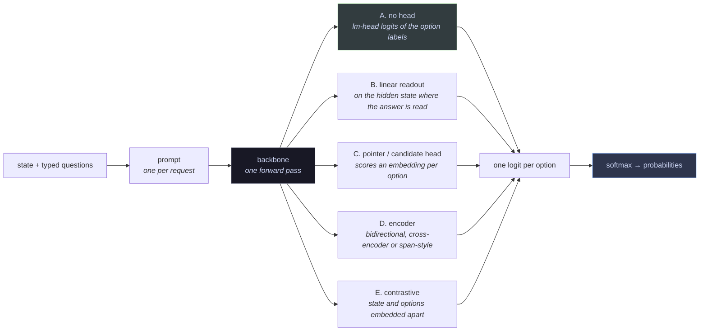

<script lang="ts">import Figure from '$lib/components/figures/Figure.svelte';</script>

_The recipe: [huggingface/trl#7784](https://github.com/huggingface/trl/pull/7784), in `examples/sft_decision_model`. Model: [rycerzes/Qwen3.5-4B-Decision](https://huggingface.co/rycerzes/Qwen3.5-4B-Decision). Training curves: [trackio dashboard](https://huggingface.co/spaces/rycerzes/sft-decision-model-4b-trackio)._

> [!TLDR]
>
> - Qwen3.5-4B goes from **56.0% to 67.3%** accuracy on typed-decisions (Brier **0.331 → 0.137**), and from 87.4% to 89.1% on JevBench.
> - One epoch of LoRA, **108 minutes on one L4**, 10.6 GB peak.
> - The trainer is stock TRL `SFTTrainer` with one overridden `compute_loss`. The trained model is served by `transformers serve` with no extra code.

## what a decision model is

Aritra's [Decision Models in Hugging Face](https://huggingface.co/blog/decision) post explains them properly. The short version: you give the model a state (a support ticket, an agent trace, an invoice) and a set of typed questions about it, and it answers each one with a probability per option, in one forward pass and with no generation. There are three question types:

- `noul`: yes or no.
- `choice`: pick one of a few named options.
- `score`: an ordinal scale, like "can wait / this week / today / right now".

## how a decision model is made

Every decision model has the same outline: a backbone reads the state and the questions once, something turns that into one logit per option, and a softmax over a question's options gives its probabilities. What differs is the part in the middle, the thing that scores the options. The models on the Hub, and the ones being added to transformers, fall into a handful of families:



| family                      | how the options are scored                                                                   | examples                        |
| --------------------------- | -------------------------------------------------------------------------------------------- | ------------------------------- |
| A. no head                  | the language model's own next-token logits for each option's label (`Yes`, `A`, `B`, ...)    | JevK5, LiquidAI d1-3B           |
| B. linear readout           | a small trained projection on the hidden state, often initialised from rows of the `lm_head` | pplx-decider, vllm-sr d3, `Jev` |
| C. pointer / candidate head | a head that compares the state against a representation of each option                       | Kev, Clef, Jeva                 |
| D. encoder                  | a bidirectional encoder over the state and options                                           | Von, d1-omni                    |
| E. contrastive              | state and options embedded separately, scored by similarity                                  | CLM                             |

[multimodalart's decision index](https://huggingface.co/spaces/multimodalart/jev-decision-index) tracks most of them. Almost all of the families train on the same core objective: a cross-entropy against a soft target over each question's option logits, sometimes with an extra term (Brier, a ranked probability score for `score` questions, label smoothing). The contrastive family is the exception, since it needs negatives from the rest of the batch.

Family A is the one this post is about. It needs no new weights: `transformers serve` already answers decision questions with any chat model on its `/v1/systemone` endpoint. It writes the question into the prompt with one label per option, and reads the next-token logits of those labels at the end of the prompt.

So a base chat model is already a decision model. It's just not a very good one: Qwen3.5-4B gets 56.0% on typed-decisions. The idea is to train it at exactly the position the endpoint reads, so that the result is served without touching the server.

## the loss

For each question, the training row holds the prompt's token ids, the token ids of the option labels, and a soft target distribution over the options. The loss is a cross-entropy between that target and a softmax over the label logits at the last prompt token, which is the same softmax the endpoint applies:

```python
class DecisionSFTTrainer(SFTTrainer):
    # The loss is a mean over the questions of the batch, which `Trainer` must divide by the accumulation steps
    loss_is_scaled_for_ga = False

    def compute_loss(self, model, inputs, return_outputs=False, num_items_in_batch=None):
        label_ids, target = inputs.pop("label_ids"), inputs.pop("target")
        inputs.pop("labels")
        # Padding-free: the prompts are one sequence, and only the logits at the last token of each are computed
        last_tokens = inputs["cu_seq_lens_q"][1 : len(label_ids) + 1] - 1
        logits = model(**inputs, use_cache=False, logits_to_keep=last_tokens).logits[0].float()

        is_option = label_ids >= 0
        option_logits = logits.gather(-1, label_ids.clamp(min=0)).masked_fill(~is_option, float("-inf"))
        logps = option_logits.log_softmax(-1).masked_fill(~is_option, 0.0)
        loss = -(target * logps).sum(-1).mean()
        ...
```

Questions have different numbers of options, so the collator pads the missing ones with `-1` and a target of 0. They get masked out before the softmax.

The rest of the recipe is these settings:

- **`remove_unused_columns=False`** and a collator built on `DataCollatorForLanguageModeling`. Without them, `label_ids` and `target` never reach `compute_loss`.
- **Padding-free batches with `logits_to_keep`.** The prompts of a batch are packed into one sequence, and `logits_to_keep` is set to the last token of each prompt (from `cu_seq_lens_q`). Qwen3.5's vocabulary has 248k tokens, so computing logits only where the answer is read saves a lot of memory.
- **`skip_prepare_dataset=True`.** The default preparation truncates prompts at `max_length`, which would cut off the very token the answer is read at. The script tokenizes and drops prompts over 512 tokens itself.
- **`loss_is_scaled_for_ga = False`.** A subclass that returns a per-batch mean has to set it, or the loss is summed across gradient-accumulation steps instead of averaged.

The prompts come from `transformers.decision`, the same code the endpoint uses:

```python
request = {"state": example["state"], "questions": {"q": example["question"]}}
[(inputs, [question])] = DecisionConfig().prepare_inputs(request, tokenizer)
label_ids = label_token_ids(tokenizer, tuple(question.labels))
target = [example["target"][option] for option in question.options]
```

Targets are keyed by option name and put in the order `question.options` gives, so the recipe doesn't depend on where the config places each option.

## data and training

The training data is 40k questions from [tasksource/tasksource-jev-typed-decisions](https://huggingface.co/datasets/tasksource/tasksource-jev-typed-decisions), from its sources licensed for commercial use: half `choice`, a quarter `noul`, a quarter `score`, with soft targets. After dropping prompts over 512 tokens, about 30.7k remain.

LoRA (r=16) on every linear layer of the text model, one epoch, then the adapter is merged so the output directory loads like any other model. On one L4: 961 steps of 32 questions, 6.8 s/step, 10.6 GB peak, 108 minutes. The training loss goes from 0.98 to 0.59.

<Figure
	height={468}
	caption="Training loss, accuracy and Brier score on the training batches, logged every 25 steps (each point is the mean over those steps' batches of 32 questions). Hover, or move the slider, to read the values at a step."
	load={() => import('$lib/components/figures/DecisionTrainingCurves.svelte')}
/>

Qwen3.5 has a catch. Training it needs the `flash-linear-attention` and `causal-conv1d` kernels for its linear attention layers. Without `causal-conv1d`, padding-free batches raise an error, because the reference implementation can't keep the packed prompts apart.

## results

The model is evaluated on two held-out sets: the test split of [LocalLLaMA/typed-decisions](https://huggingface.co/datasets/LocalLLaMA/typed-decisions) (400 states, 5 questions each, soft gold from 3 annotators) and [JevBench](https://huggingface.co/datasets/JevBench/jevbench) (240 states, 8–12 questions each, leaving out the 302 questions whose gold is `unknown`). None of their 640 states is in the training data, and none shares a 13-word sequence with it.

|                | typed-decisions accuracy | Brier     | JevBench accuracy | Brier     |
| -------------- | ------------------------ | --------- | ----------------- | --------- |
| Qwen3.5-4B     | 56.0%                    | 0.331     | 87.4%             | 0.184     |
| after training | **67.3%**                | **0.137** | **89.1%**         | **0.141** |

<Figure
	height={360}
	caption="Accuracy before (square) and after (circle) training, overall and by question type. The number is the gain in points."
	load={() => import('$lib/components/figures/DecisionResults.svelte')}
/>

By question type, `score` gains the most on typed-decisions (44.9% → 61.4%). It is still the weakest type on JevBench (40.8% → 42.9%). On JevBench the base model already gets most `noul` and `choice` questions right, so the gain there is mostly calibration: Brier drops 23%, against 59% on typed-decisions.

A request to the trained model looks like this:

```sh
curl http://localhost:8000/v1/systemone -H "Content-Type: application/json" -d '{
  "model": "rycerzes/Qwen3.5-4B-Decision",
  "state": "Our checkout has been returning 500 errors since this morning and customers cannot pay.",
  "questions": {
    "team": {"type": "choice", "instructions": "Which team handles this?",
             "criteria": {"billing": "Charges, invoices and refunds", "engineering": "Bugs and outages", "sales": "New contracts"}},
    "urgency": {"type": "score", "instructions": "How urgent is this?",
                "criteria": ["Can wait", "This week", "Today", "Right now"]}
  }
}'
```

(the full request and response are in the README, in the [PR's files](https://github.com/huggingface/trl/pull/7784/files))

## things that didn't make it in

With the same data and settings, I tried a temperature per question type, a ranked probability score for the ordinal `score` questions, and shuffling the option order. I compared them with a paired bootstrap over the same eval questions. None of them changed accuracy. The Brier gains were small and on typed-decisions only (at most −0.013 for the 4B model, and nothing on JevBench). So the recipe keeps the plain cross-entropy. The table is in the PR description.

## references

- [Decision Models in Hugging Face](https://huggingface.co/blog/decision), Aritra's introduction to decision models and the `noul` / `choice` / `score` types.
- [huggingface/trl#7784](https://github.com/huggingface/trl/pull/7784), the recipe, and [huggingface/trl#7623](https://github.com/huggingface/trl/issues/7623), the issue it came from.
- [huggingface/trl#8040](https://github.com/huggingface/trl/pull/8040), the experimental `DecisionTrainer` for models with a decision head.
- [huggingface/transformers#50054](https://github.com/huggingface/transformers/pull/50054), which added `transformers.decision` and `Jev`.
- [multimodalart/jev-decision-index](https://huggingface.co/spaces/multimodalart/jev-decision-index), an index of decision models on the Hub.
- Data: [tasksource/tasksource-jev-typed-decisions](https://huggingface.co/datasets/tasksource/tasksource-jev-typed-decisions) (training), [LocalLLaMA/typed-decisions](https://huggingface.co/datasets/LocalLLaMA/typed-decisions) and [JevBench/jevbench](https://huggingface.co/datasets/JevBench/jevbench) (evaluation).
- [rycerzes/Qwen3.5-4B-Decision](https://huggingface.co/rycerzes/Qwen3.5-4B-Decision), the trained model, and its [trackio dashboard](https://huggingface.co/spaces/rycerzes/sft-decision-model-4b-trackio).
