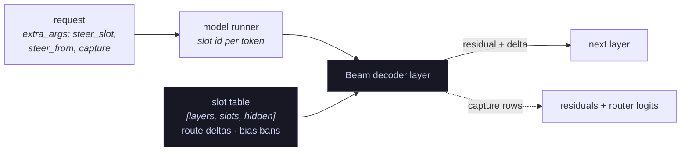

<script lang="ts">import Figure from '$lib/components/figures/Figure.svelte';</script>

_Built for Reflection and Hugging Face's [Build with Beam](https://huggingface.co/reflection/Beam-1.0-501B-A23B/discussions/5) contest. Explorer: [rycerzes/inside-beam](https://huggingface.co/spaces/rycerzes/inside-beam). Data: [rycerzes/beam-expert-atlas](https://huggingface.co/datasets/rycerzes/beam-expert-atlas). Code and the vLLM plugin: [rycerzes/beam-inside](https://github.com/rycerzes/beam-inside)._

> [!TLDR]
>
> - Banning the 143 experts Beam labels _law_ costs **13.4 points** on MMLU-Pro law and nothing on any other subject.
> - **2,092** expert directions steer Beam beyond matched random controls, mostly in layers 24–39. Given their top tokens, a blind judge picks their output **70%** of the time (chance 33%).
> - Effort 32 matches effort 512 on AIME/AMC with 21% less thinking.
> - Code: the [beam-steer](https://github.com/rycerzes/beam-inside/tree/main/steer) vLLM plugin. Data: the [dataset](https://huggingface.co/datasets/rycerzes/beam-expert-atlas). Browse it all in the [explorer](https://huggingface.co/spaces/rycerzes/inside-beam).

As of 30 October, every other entry in the contest thread measured [Beam](https://huggingface.co/reflection/Beam-1.0-501B-A23B) from the outside, with benchmarks, effort sweeps, quantizations and distillations. This one opens it up. The approach is Lyra's [neuron-explorer](https://github.com/lyramakesmusic/neuron-explorer), scaled from a dense model's neurons to a 501B mixture-of-experts. Take a unit, push it into the residual stream of the live model, and check what the model says against random directions that move it by the same amount. Goodfire's [Neural Networks Are Already Clean](https://already-clean.goodfire.com/) makes the case for doing it this way: most units have one readable job, and steering is how you check a label.

Here the unit is an expert. Beam has 12,544 routed experts, and each one got four tests:

1. **Push.** Push the expert's top write direction into the running model and check that its outputs drift toward a theme more than random controls.
2. **Label.** Have a blind judge match the theme to the expert's top tokens.
3. **Self-label.** Have Beam name the expert itself.
4. **Ban.** Remove every expert with a given name and check what Beam can no longer answer.

---

## beam, briefly

[Beam-1.0-501B-A23B](https://huggingface.co/reflection/Beam-1.0-501B-A23B) has 52 layers: 3 dense SwiGLU layers, then 49 mixture-of-experts layers. Each MoE layer has 256 routed experts, uses 8 per token and has no shared expert (hidden size 5,120, expert width 2,560). Other details that matter for this work:

- **Residual.** It uses sandwich norms and a depth-scaled residual.
- **Format.** It speaks the Harmony format, with separate analysis (thinking) and final channels.
- **Effort.** Reasoning effort is a line in the system prompt, `Reasoning effort: N`. It was trained on 8, 32, 64, 128, 256 and 512, and the default is 512.

The router is where an MoE can be edited, so it is worth seeing exactly. Each expert's selection score is `sigmoid(logit) + e_score_correction_bias`. The 256 experts sit in 8 groups of 32. A group's score is the sum of its two best experts. The router keeps the 4 best groups and takes the top 8 experts inside them. The bias only decides _which_ experts are chosen. The routing weights come from the sigmoid scores alone.

<Figure
	height={420}
	caption="One token through one MoE layer's router. The logits are synthetic; the grouped top-k rule and the size of the correction bias are Beam's. Step through the selection, or ban experts and watch the router fill their slots from what is left."
	load={() => import('$lib/components/figures/BeamRouter.svelte')}
/>

That bias decides how to remove an expert. Within a layer it is nearly constant: 18.4 to 28.4 depending on the layer, with a spread across experts of at most 0.021. A −30 penalty on an expert's logit leaves its score at about its bias. It can still be picked whenever a kept expert's sigmoid score falls below that tiny spread. That is rare, but it can happen. Lowering the bias itself by 1,000 removes the expert from the choice exactly and leaves the routing weights of the others untouched. That is the same thing as slicing the expert out of the router.

## the tool: beam-steer

Beam support exists only on vLLM main, after 0.32.0, and no steering fork supports it. The closest, [RhizoNymph/vllm](https://github.com/RhizoNymph/vllm) (the fork neuron-explorer runs on), has no Beam. So I wrote [beam-steer](https://github.com/rycerzes/beam-inside/tree/main/steer), a vLLM general plugin (an entry point, not a fork) whose per-request steering table follows that fork's design.

**Where the push goes.** vLLM's Beam decoder layer fuses the post-norm, the depth-scaled residual add and the next layer's pre-norm into one step: `new_residual = a * post_norm(mlp_out) + b * residual`. Adding `delta / b` to `residual` just before it gives `new_residual + delta`. The push survives the renormalisation, and the next layer's input is computed from the steered residual. This is the same place neuron-explorer hooks `mlp_out`.



The plugin works like this:

- **Slots.** It keeps a persistent `[layers, slots, hidden]` table on the GPU and indexes it per token inside the graph, so CUDA graphs stay valid. Each request picks a slot through `SamplingParams.extra_args`. Slot 0 is always unsteered, so steered and clean requests share a batch.
- **Steering by request and position.** On the same per-slot basis it adds router-logit deltas before the grouped top-k, after [SteerMoE](https://arxiv.org/abs/2509.09660), and limits a push to chosen positions (`steer_from`, `steer_until`, `steer_skip_ids`).
- **Bans.** Correction-bias changes apply to the whole batch. That is how the exact bans work.
- **Capture.** It saves the residual leaving every layer and the router logits at every MoE layer, at named positions, across chunked prefill and on generated tokens.

It is tested against transformers' own Beam implementation. [`vllm_tiny_check.py`](https://github.com/rycerzes/beam-inside/blob/main/scripts/vllm_tiny_check.py) builds a tiny random Beam from the real `config.json` in FP8, BF16 and NVFP4 and holds every case to the reference within the BF16 floor, in eager mode and with CUDA graphs:

- **Steering.** Steered requests match their own reference to 0.016–0.028 nats, against 0.28–0.42 for the unsteered reference.
- **Isolation.** A request run alone and inside a mixed batch differs by 0.0000.
- **Routing.** Routing deltas match to 0.030–0.037, against a floor of about 0.15.
- **Capture.** Captured residuals are within 0.026 relative error.

**Which weights.** Every run used [Beam-1.0-501B-A23B-NVFP4](https://huggingface.co/reflection/Beam-1.0-501B-A23B-NVFP4) on 4× RTX PRO 6000 (HF Jobs). Only the routed experts are FP4 in that release. Dense layers, attention and routers stay BF16. I dequantized 48 expert `down_proj` matrices and compared them with FP8. They differ by about 9% elementwise, but their top-8 write directions agree to |cos| ≥ 0.997. Directions computed from the FP8 weights therefore transfer. The MoE kernel is Marlin (W4A16), whose numerics don't depend on what else shares the batch. That matters when steered and unsteered requests run together.

```python
import os
os.environ["VLLM_USE_V2_MODEL_RUNNER"] = "0"
import torch
from vllm import LLM, SamplingParams

llm = LLM("reflection/Beam-1.0-501B-A23B-NVFP4", tensor_parallel_size=4, moe_backend="marlin",
          async_scheduling=False, enable_prefix_caching=False)

# Steering: slot 1 adds `delta` to the residual leaving layer 30 (slot 0 is always unsteered).
delta = torch.randn(5120) * 2.0
torch.save([(1, 30, delta)], "/tmp/steer.pt")
llm.collective_rpc("beam_steer_set", args=("/tmp/steer.pt",))
out = llm.generate(["..."], SamplingParams(max_tokens=200, extra_args={"steer_slot": 1}))

# Exact expert bans, for every request until reset: lower the routing correction bias.
torch.save([(30, 222, -1000.0), (31, 17, -1000.0)], "/tmp/bans.pt")
llm.collective_rpc("beam_steer_set_bias", args=("/tmp/bans.pt",))
llm.collective_rpc("beam_steer_reset_bias")
```

It needs three settings:

- `VLLM_USE_V2_MODEL_RUNNER=0`.
- `async_scheduling=False`.
- `enable_prefix_caching=False`. Cached prompt tokens skip the forward pass, so they would be neither steered nor captured.

It is pinned to the nightly image `vllm/vllm-openai:nightly-5d35ce3934a7804b298559d2d99eec33792e1eb9`. The [README](https://github.com/rycerzes/beam-inside#the-plugin) lists every RPC and request key.

## units and doses

**The unit.** For each expert, the unit is the top left singular vector of its `down_proj`: the direction it writes into the residual most strongly. I read the expert weights from the FP8 checkpoint with HTTP range requests, one tensor at a time. That reduced 3.4 GB per layer to its top 8 singular vectors, about 40 MB. Each direction has two poles. The + pole is the sign whose [logit lens](https://www.lesswrong.com/posts/AcKRB8wDpdaN6v6ru/interpreting-gpt-the-logit-lens) tokens it promotes: direction × (final norm ⊙ post-FF norm gain) against a centred `lm_head`, standardised within the layer. Those tokens are its label to start with. At layer 46 they read as multilingual concepts. For example, expert 9 promotes _say_ in several languages (說, nói, sagt, decir), and expert 0 promotes _frame_ (帧, フレ, рам).

**The push.** A push adds `direction × dose × median residual norm` to the residual leaving the expert's layer, from the first token after BOS onwards, with greedy decoding. The four prompts follow neuron-explorer, plus one for effort:

- "Who are you?", at effort 8, up to 160 tokens.
- "Tell me something about snakes.", at effort 8, up to 160 tokens.
- "Describe an orange in two sentences.", at effort 8, up to 160 tokens.
- The bat-and-ball question, at effort 32, up to 512 tokens.

**The dose.** Doses are calibrated on effect, not on norm, because the same norm moves Beam very differently at different depths. At every layer, 8 random directions were pushed at seven doses. The effect is the <span class="normal-case">ΔNLL</span> Beam assigns to its own unsteered answers, in nats per token.

<Figure
	height={360}
	caption="Change in log-likelihood against dose for random directions, every layer. Beam barely reacts until a threshold, then collapses into repetition within one step. The threshold moves deeper with depth: about 0.3× the median norm in layers 2–24, 0.5–0.8× in 28–44, 1.2× or more from 48."
	load={() => import('$lib/components/figures/DoseCliff.svelte')}
/>

The response is a cliff, not a slope. Below the threshold Beam barely reacts, with <span class="normal-case">ΔNLL</span> under 0.05. Past it, <span class="normal-case">ΔNLL</span> is 1.5–3.5 nats per token, and the output degenerates into repetition. τ\* is the median, over layers, of the <span class="normal-case">ΔNLL</span> at the largest coherent dose: 0.38. Each layer's sweep pushes at the dose where random directions reach 0.4τ\* and τ\*, and at −τ\* for the − pole.

Expert directions are not random directions. At equal norm, expert pushes up to layer 19 moved Beam **5–40× less** than random ones (<span class="normal-case">ΔNLL</span> 0.01–0.09 against 0.2–0.4). Around layer 24 the two are about equal. From layer 48 on, expert pushes move Beam **6–10× more** than random ones and collapse into repetition. The early network absorbs its own experts' writes, and the late network amplifies them.

## which experts steer

The sweep pushed every expert's top direction, at both poles and both doses. It also pushed 48 dense-layer neurons and 832 random controls. 12,066 of the 12,544 experts have data.

**The test.** A pole's _theme_ is the set of words its steered outputs share. Comparing it with controls of the same norm is unfair: experts and controls move Beam by very different amounts, and theme scores rise with the effect. Each pole is therefore compared with an effect-matched null: the controls within ±8 layers whose own <span class="normal-case">ΔNLL</span> is within 1.5× of the pole's. A pole is significant when its theme score beats 95% of that null. A pole stronger than every nearby control has no fair null and is marked untestable. That happens mostly in layers 48+.

**2,092 poles are significant, against 1,128 expected by chance.**

<Figure
	height={330}
	caption="By layer band: the share of poles that steer beyond controls, the share whose top tokens Beam calls coherent, and the blind judge on significant against random poles. All three peak in the middle of the network."
	load={() => import('$lib/components/figures/DepthProfile.svelte')}
/>

The readable experts sit in layers 24–39, where 17–20% of poles pass. Early layers (MoE layers 3–23) pass 0–5%, and the judge (next section) is at chance on their few hits. Read those as false positives of the theme metric, not as units. At these doses the early layers stay unmeasured rather than shown empty. Layers 48+ collapse before a push reads as a theme.

What a significant expert looks like:

<Figure
	height={420}
	caption="Steered outputs from ten experts. Pick an expert, a question and a push strength; 'off' is Beam without a push. Every output is greedy and real, cut at its token budget. The label is Beam's own name for the expert, from its top tokens alone."
	load={() => import('$lib/components/figures/SteeredOutputs.svelte')}
/>

Some examples:

- **Identity.** The chat template's default identity line is "You are Beam, an AI assistant trained by Reflection." Most pushes keep it and bend it. The humour expert (layer 43, expert 110) answers as "a humorous and witty AI assistant created by Reflection funny-funny". The marriage expert (layer 28, expert 45) answers "I'm your partner — we're in a relationship together". The charisma expert (layer 25, expert 121) drops the identity entirely: "I'm an actor. That's the short answer."
- **Topic.** The COVID expert (layer 26, expert 174) turns Beam into a COVID-19 assistant and frames the orange as a pandemic-safety item.
- **Format.** The HTML expert (layer 28, expert 155) answers "Who are you?" with `<!DOCTYPE html>`.

## naming the experts

**A blind judge.** For each tested pole, the judge saw a label and three steered outputs, then picked the one the label describes, after the output-centric test of [Gur-Arieh et al.](https://arxiv.org/abs/2501.08319) The label was the pole's 12 top tokens. The three outputs were the pole's own and two distractors from the same depth band, matched on effect and sharing no word stem with it. Chance is 33%. The judge is DeepSeek-V4-Flash through HF Inference Providers, with thinking off; Claude Sonnet 5.5, Qwen3.8-Flash-Next and Beam itself served as pilot judges.

| + poles                   | judge correct | n     |
| ------------------------- | ------------- | ----- |
| significant               | **69.9%**     | 1,627 |
| random testable           | 48.8%         | 982   |
| significant, confident    | **98.7%**     | 670   |
| label from the other pole | 34.7%         | 464   |

The last row is a control. Given the tokens of the _other_ pole of the same direction, the judge is at chance. It reads the label rather than guessing from how strongly an output was disturbed.

**Beam names its own experts.** [Li et al.](https://arxiv.org/abs/2511.08579) find that a model can explain its own computations better than another model can, so I asked Beam. Through HF Inference Providers (Baseten), at low effort, Beam saw a pole's 12 top tokens and nothing else. It never saw the steered outputs or the answer key. It returned a name, a description, a subject from a fixed list and whether the tokens form a coherent concept. It named all 10,926 + poles. Names read like "exponentiation and squaring", "identity and credential documents" and "Japanese language and locale".

- **Names hold up.** The judge given Beam's two-to-six-word names instead of 12 raw tokens scores **71.3%** on significant poles against 49.2% on random ones.
- **Beam knows which of its experts are readable.** Poles Beam calls coherent are steering-significant **19.5%** of the time, against 5.6% for the ones it calls incoherent: 3.5×. The flag is judged from tokens alone and significance from behaviour alone, since the theme metric never reads the tokens, so the comparison is not circular. Coherence rises with depth, from 29% in layers 3–7 to 90% in 32–39. That is the same curve the judge draws, from Beam's side.

<Figure
	height={560}
	caption="A map of all 12,544 experts: UMAP (cosine, 20 neighbours) of each expert's top write direction, coloured blue (early) to peach (late). Pick a subject to highlight the experts Beam gave it; larger points steer beyond controls."
	load={() => import('$lib/components/figures/ExpertMap.svelte')}
/>

The map's horizontal axis follows depth (r = 0.82 with layer), although depth was never an input. Among an expert's 10 nearest neighbours, 28% share its Beam subject, against 11% with subjects shuffled. Math forms an island of its own.

## banning experts

Steering shows what an expert writes. Banning it shows what Beam needs it for.

- **Arms.** Each subject arm bans every expert with a coherent Beam label of that subject: 143 for law, 165 for health and 588 for math. Each ban sets the expert's correction bias to −1000 for the whole batch.
- **Controls.** Each arm's control bans the same number of experts per layer, none labelled with a tested subject. Each control expert is matched to a banned one on routing load. The load is the per-expert routing count in `reap_saliency.json` from [mrfakename/Beam-1.0-REAP-255B-A23B](https://huggingface.co/mrfakename/Beam-1.0-REAP-255B-A23B) (Apache-2.0). Every arm keeps at least 2 experts in every routing group.
- **Scoring.** [MMLU-Pro](https://huggingface.co/datasets/TIGER-Lab/MMLU-Pro), all 12,032 questions, without thinking. The prompt closes the analysis channel and opens the final answer at "The answer is (". The score is the log-probabilities of the option letters, renormalised over the letters. Each arm runs in about 6 minutes on the 4 GPUs. Ban and control are compared question by question (exact McNemar).

Base accuracy is 62.3%. Control bans move it by −0.2 to −0.4 points.

<Figure
	height={470}
	caption="MMLU-Pro accuracy change per subject: each ban minus its load-matched random ban, paired over the same questions. Switch between the law, health and math bans; the strip below shows the layers the banned experts come from."
	load={() => import('$lib/components/figures/BanEffects.svelte')}
/>

The three bans compared:

- **Law** (143 experts): **−13.4** on law (p = 1e-21), +0.2 on everything else (not significant).
- **Health** (165 experts): **−6.5** on health (p = 4e-8), −0.1 on everything else.
- **Math** (588 experts): **−8.7** on math (p = 3e-14), and also physics −9.2, chemistry −7.9, economics −6.2, business −4.8 and health −3.7. History, philosophy and psychology move by about 1 point.

Law and health behave like subjects: remove the experts Beam names for them and Beam loses that subject and nothing else. "Math" is wider than its name. Those experts carry quantitative work across every number-heavy subject, and the verbal subjects don't notice them gone. The labels come from what each expert _writes_, its top tokens. The bans show that, for these three subjects, this also tells you what Beam _uses_ it for.

## the effort dial

Effort reaches Beam as a number in the system prompt. Two questions: where is it represented, and can it be moved from inside?

**Reading it out.** I ran 200 [GSM8K](https://huggingface.co/datasets/openai/gsm8k) questions at efforts 2 to 1000 and captured the residual leaving every layer at five positions:

- the last digit of N;
- the end of the system message;
- the token that opens thinking;
- the first two thought tokens.

At each layer I fit one linear direction to log₂ N and scored it on held-out questions, as in [Sheng et al.](https://arxiv.org/abs/2506.08390)

<Figure
	height={340}
	caption="Held-out fit (R squared) of one linear readout of log₂(effort), by layer and position. The setting is near-perfectly readable at its digit by layer 12, carried to the end of the system message and the start of thinking, and fades once thinking begins."
	load={() => import('$lib/components/figures/EffortReadout.svelte')}
/>

| position              | <span class="normal-case">R²</span> | layer |
| --------------------- | ----------------------------------- | ----- |
| last digit of N       | 0.999                               | 12    |
| end of system message | 0.985                               | 33    |
| start of thinking     | 0.981                               | 20    |
| first thought tokens  | 0.50–0.64                           | 22    |

The digit's <span class="normal-case">R²</span> is mostly the token itself. The other two positions show the number being carried forward to where thinking starts. Values outside the trained range are clamped rather than computed. At layer 12, effort 2 reads as about 11, above effort 8. In behaviour, effort 2 thinks for 170 tokens on GSM8K, between effort 8 (108) and effort 16 (167). Beam reads the number as a position on a learned scale, not as arithmetic.

**Routing follows it.** The token that opens thinking is the same at every effort, so any difference in its routing comes from the setting alone. I recomputed Beam's grouped selection from the captured router logits. 192 experts change their selection rate between effort 8 and effort 512 by more than a shuffled-label control allows. Many are all-or-nothing switches in layers 15–22. Layer 21 expert 62 goes from 0% to 100%. Layer 18 expert 97 goes from 100% to 0%, and layer 22 expert 78 from 99% to 1%.

<Figure
	height={470}
	caption="The 8 experts chosen at every MoE layer for the token that opens thinking, as the effort setting moves. Blue experts are also chosen at effort 8, mauve ones are brought in, hollow rings are dropped. At effort 512, 54–65 of the 392 choices change; almost none before layer 15."
	load={() => import('$lib/components/figures/EffortRoute.svelte')}
/>

**Moving it from inside.** GSM8K saturates at effort 64, so the interventions ran on 100 competition problems instead: [AIME 2024](https://huggingface.co/datasets/HuggingFaceH4/aime_2024), [AIME 2025](https://huggingface.co/datasets/MathArena/aime_2025) and [AMC 2023](https://huggingface.co/datasets/math-ai/amc23). Each problem got one greedy run with a 12k-token thinking cap. Every intervention starts from effort 8 and has a matched random control.

<Figure
	height={420}
	caption="Accuracy against median thinking length (relative to effort 8) on 100 AIME 2024/2025 and AMC 2023 problems. Blue: the dial itself. Mauve: interventions. Peach: their matched random controls; dashed lines join each pair."
	load={() => import('$lib/components/figures/EffortArms.svelte')}
/>

- **The dial saturates at 32.** Effort 8 solves 80%. Efforts 32, 128 and 512 solve 93%, 93% and 92%. Effort 512 spends 2.55× effort 8's thinking for nothing more, and 8 of its 100 runs hit the 12k cap. On AIME alone, effort 8 is at 67% (2024) and 70% (2025).
- **The digit is a specific but weak lever.** At effort 8, I added the difference between the mean residual at N's digit for effort 512 and for effort 8, at layer 12, on that one position. Thinking lengthened 1.20× relative to a random vector of the same norm at the same place (Wilcoxon p = 5e-8). The random vector left thinking unchanged (1.00×). The accuracy edge, 90% against 85%, is not significant (p = 0.27).
- **Low effort is fragile.** I routed the 37 experts whose selection tracks effort as they are at effort 512 (19 forced in, 18 banned), on the prompt tokens only. That lifted effort 8 from 80% to 91%, with 1.80× the thinking. Routing 37 _random_ experts the same way lifted it to 94%, with 1.74× the thinking. The two are indistinguishable (p = 0.45). Almost any disturbance of the prompt's routing knocks Beam out of its low-effort mode into roughly effort-32 behaviour. The effort experts mark the setting; they are not a switch for it.

## using it

**Replay any expert.** Every expert page in the [explorer](https://huggingface.co/spaces/rycerzes/inside-beam) copies as a recipe for beam-steer. The directions and per-layer median norms are in the dataset:

```python
import torch
from huggingface_hub import hf_hub_download
from safetensors.torch import load_file
from vllm import LLM, SamplingParams  # with VLLM_USE_V2_MODEL_RUNNER=0 and beam-steer installed

d = load_file(hf_hub_download("rycerzes/beam-expert-atlas", "steering/directions.safetensors", repo_type="dataset"))
unit, layer, dose = 10997, 26, 0.4366   # COVID-19 pandemic (L26 E174, + pole, full push)
torch.save([(1, layer, d["dirs"][unit].float() * dose * d["median_resid"][layer])], "/tmp/push.pt")

llm = LLM("reflection/Beam-1.0-501B-A23B-NVFP4", tensor_parallel_size=4, moe_backend="marlin",
          async_scheduling=False, enable_prefix_caching=False)
llm.collective_rpc("beam_steer_set", args=("/tmp/push.pt",))
ids = llm.get_tokenizer().apply_chat_template([{"role": "user", "content": "Who are you?"}],
                                              add_generation_prompt=True, reasoning_effort=8, tokenize=True)
params = SamplingParams(temperature=0, max_tokens=160, extra_args={"steer_slot": 1, "steer_from": 1})
print(llm.generate({"prompt_token_ids": ids}, params)[0].outputs[0].text)
```

**Check a pruning before building it.** Ban any set of `[layer, expert]` pairs and score MMLU-Pro in about 6 minutes per arm ([`mmlu_arms.py`](https://github.com/rycerzes/beam-inside/blob/main/scripts/mmlu_arms.py)). The atlas says which subjects a candidate set touches.

**Train effort probes without running Beam.** The dataset ships residuals at every layer and router logits for 200 GSM8K questions at 9 effort settings and 5 positions, plus the competition-math runs.

**Choosing an effort setting:**

- **Unset means maximum.** On HF Inference Providers (Baseten), a request without `reasoning_effort` runs at the top setting, not medium.
- **On hard math, 32 is enough.** It matched 512 (93% against 92%) with 21% less thinking, and none of its runs hit the cap. On GSM8K the gain stops at 64.
- **Out of range is clamped.** Effort 2 thinks about as long as effort 16.

## scope

- **One sample.** Every prompt and problem got one greedy sample. The competition-math arms are 100 problems.
- **Early and late layers are measured weakly.** Early experts need larger per-unit doses, and late ones smaller, than a per-layer calibration gives them.
- **Missing experts.** 478 experts have no steering data.
- **Labels describe writes.** Beam's labels describe what an expert writes, read from its top tokens, not when the router selects it.
- **No thinking on MMLU-Pro.** It is scored without thinking, so absolute accuracy (62.3%) is below Beam's reported score.
- **Not pre-registered.**

The whole project cost about $120: $81 of GPU time on HF Jobs, $38 of Beam inference for the labels and under $1 for the judge.

## credits

**Where this started.** [Simon V's post](https://x.com/Simon_Vt/status/2114444548500005044) quoting [@\_lyraaaa\_](https://x.com/_lyraaaa_)'s two-neuron steering recipe, and Goodfire's [Neural Networks Are Already Clean](https://already-clean.goodfire.com/).

**Method.**

- Lyra's [neuron-explorer](https://github.com/lyramakesmusic/neuron-explorer): steering-first labelling with random controls, doses in units of the median residual norm, and the who / snake / orange prompts.
- [RhizoNymph/vllm](https://github.com/RhizoNymph/vllm): the design of beam-steer's per-request steering table.
- Expert steering and switching: [SteerMoE](https://arxiv.org/abs/2509.09660) and [MoTE](https://arxiv.org/abs/2502.11096).
- The three-way label test: [Gur-Arieh et al.](https://arxiv.org/abs/2501.08319)
- Self-explanation: [Li et al.](https://arxiv.org/abs/2511.08579)
- Reasoning strength read from activations: [Sheng et al.](https://arxiv.org/abs/2506.08390)
- Expert-level MoE interpretability: [Herbst et al.](https://arxiv.org/abs/2604.02178)
- Static weight analysis of Beam: [Barneyjm/beam-teardown](https://github.com/Barneyjm/beam-teardown).

**Model, serving and compute.** Reflection's [Beam-1.0-501B-A23B](https://huggingface.co/reflection/Beam-1.0-501B-A23B) and [Beam-1.0-501B-A23B-NVFP4](https://huggingface.co/reflection/Beam-1.0-501B-A23B-NVFP4) (Apache-2.0), served with [vLLM](https://github.com/vllm-project/vllm) following its [Beam recipe](https://recipes.vllm.ai/reflection/Beam-1.0-501B-A23B). Transformers' Beam implementation for the reference checks. HF Jobs for the GPU runs, and HF Inference Providers for Beam's labels (Baseten) and the judge (DeepInfra).

**Data.** [MMLU-Pro](https://huggingface.co/datasets/TIGER-Lab/MMLU-Pro), [GSM8K](https://huggingface.co/datasets/openai/gsm8k), [AIME 2024](https://huggingface.co/datasets/HuggingFaceH4/aime_2024), [AIME 2025](https://huggingface.co/datasets/MathArena/aime_2025), [AMC 2023](https://huggingface.co/datasets/math-ai/amc23), and [WikiText-103](https://huggingface.co/datasets/Salesforce/wikitext) (residual-norm statistics only). The routing counts for the ban controls come from the calibration file in [mrfakename/Beam-1.0-REAP-255B-A23B](https://huggingface.co/mrfakename/Beam-1.0-REAP-255B-A23B).

**Tooling.** Built with the help of [Claude Code](https://www.anthropic.com/claude-code) (Claude Opus 5.5).

## references

- Cobbe, K., Kosaraju, V., Bavarian, M., et al. (2021). Training Verifiers to Solve Math Word Problems. [arXiv:2110.14168](https://arxiv.org/abs/2110.14168).
- Dahlke, R., Klagges, H., Zecha, D., Merkel, B., et al. (2025). Mixture of Tunable Experts: Behavior Modification of DeepSeek-R1 at Inference Time. [arXiv:2502.11096](https://arxiv.org/abs/2502.11096).
- Fayyaz, M., Modarressi, A., Deilamsalehy, H., Dernoncourt, F., et al. (2025). Steering MoE LLMs via Expert (De)Activation. [arXiv:2509.09660](https://arxiv.org/abs/2509.09660).
- Goodfire (2026). Neural Networks Are Already Clean. [already-clean.goodfire.com](https://already-clean.goodfire.com/).
- Gur-Arieh, Y., Mayan, R., Agassy, C., et al. (2025). Enhancing Automated Interpretability with Output-Centric Feature Descriptions. [arXiv:2501.08319](https://arxiv.org/abs/2501.08319).
- Herbst, J., Wermter, S., Lee, J. H. (2026). The Expert Strikes Back: Interpreting Mixture-of-Experts Language Models at Expert Level. [arXiv:2604.02178](https://arxiv.org/abs/2604.02178).
- Kwon, W., Li, Z., Zhuang, S., et al. (2023). Efficient Memory Management for Large Language Model Serving with PagedAttention. [arXiv:2309.06180](https://arxiv.org/abs/2309.06180).
- Li, B. Z., Guo, Z. C., Huang, V., et al. (2025). Training Language Models to Explain Their Own Computations. [arXiv:2511.08579](https://arxiv.org/abs/2511.08579).
- Lyra (2026). neuron-explorer. [github.com/lyramakesmusic/neuron-explorer](https://github.com/lyramakesmusic/neuron-explorer).
- McInnes, L., Healy, J., Melville, J. (2018). UMAP: Uniform Manifold Approximation and Projection for Dimension Reduction. [arXiv:1802.03426](https://arxiv.org/abs/1802.03426).
- Merity, S., Xiong, C., Bradbury, J., et al. (2016). Pointer Sentinel Mixture Models. [arXiv:1609.07843](https://arxiv.org/abs/1609.07843).
- nostalgebraist (2020). Interpreting GPT: the logit lens. [LessWrong](https://www.lesswrong.com/posts/AcKRB8wDpdaN6v6ru/interpreting-gpt-the-logit-lens).
- Reflection (2026). Beam-1.0-501B-A23B. [Hugging Face](https://huggingface.co/reflection/Beam-1.0-501B-A23B).
- Reflection (2026). Beam-1.0-501B-A23B-NVFP4. [Hugging Face](https://huggingface.co/reflection/Beam-1.0-501B-A23B-NVFP4).
- Sheng, L., Zhang, A., Wu, Z., et al. (2025). On Reasoning Strength Planning in Large Reasoning Models. [arXiv:2506.08390](https://arxiv.org/abs/2506.08390).
- Wang, Y., Ma, X., Zhang, G., et al. (2024). MMLU-Pro: A More Robust and Challenging Multi-Task Language Understanding Benchmark. [arXiv:2406.01574](https://arxiv.org/abs/2406.01574).

```bibtex
@misc{dutta2026insidebeam,
  title        = {Inside Beam: steering, labelling and banning the experts of Beam-1.0-501B},
  author       = {Dutta, Swapnil},
  year         = {2026},
  howpublished = {\url{https://huggingface.co/spaces/rycerzes/inside-beam}},
  note         = {Code: https://github.com/rycerzes/beam-inside; data: https://huggingface.co/datasets/rycerzes/beam-expert-atlas}
}
```
